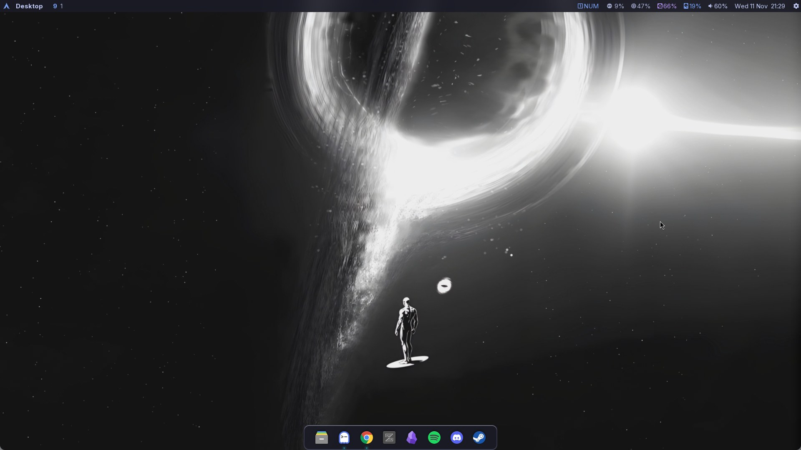
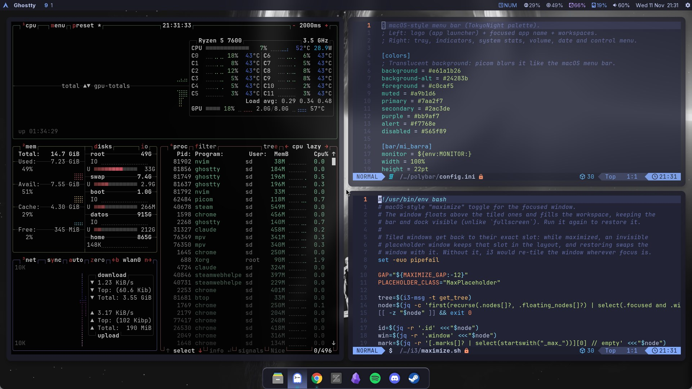
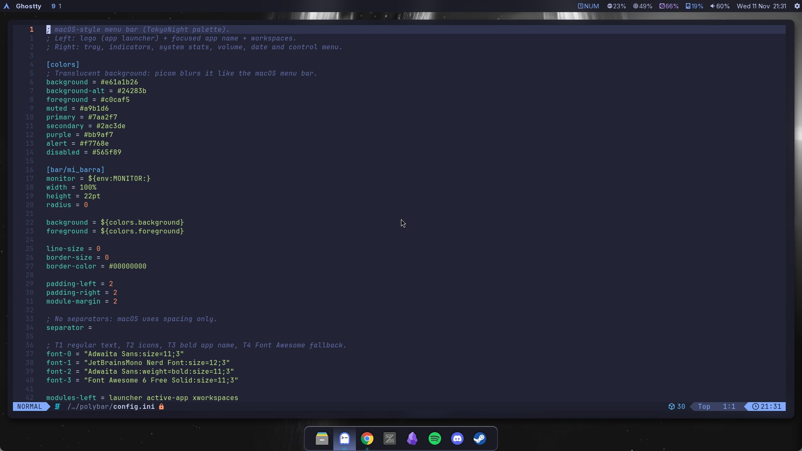
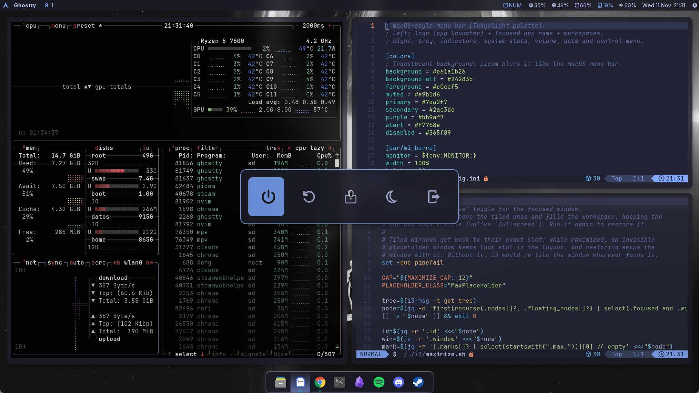

# 🌙 Arch Linux Dotfiles - TokyoNight Edition

Un entorno de trabajo híbrido basado en **i3wm** y **Arch Linux**, diseñado con un enfoque minimalista y simétrico utilizando la paleta de colores **TokyoNight**, con una capa visual inspirada en macOS (barra de menú, dock, sombras y animaciones) sin perder el tiling de i3.

Este setup está optimizado para ofrecer el máximo rendimiento en un entorno multipropósito: desde flujos de trabajo de desarrollo (Data Science, Machine Learning, PHP/Laravel) hasta configuraciones de gaming y sim racing.

## 📸 Screenshots

**Escritorio:** barra de menú estilo macOS, dock (Plank) y fondo animado.


**Tiling:** ventanas lado a lado con gaps, sombras y esquinas redondeadas.


**Maximizar (`$mod+m`):** la ventana flota sobre las demás sin tapar la barra ni el dock.


**Power Menu (Rofi).**


## ✨ Características Destacadas

* **Gestor de Ventanas:** i3wm configurado para un flujo de trabajo rápido con atajos de teclado y reglas de ventanas flotantes específicas.
* **Barra de Estado:** Polybar estilo barra de menú de macOS: logo de Arch (abre el launcher), nombre de la app enfocada, workspaces, y a la derecha tray, stats, volumen, fecha y menú de control. Fondo translúcido con blur de picom.
* **Compositor (picom):** esquinas redondeadas, blur, sombras suaves y animaciones de apertura/cierre/redimensionado.
* **Maximizar estilo macOS (`$mod+m`):** la ventana flota sobre las demás ocupando el workspace sin tapar la barra ni el dock; repetir el atajo la restaura. `$mod+f` sigue siendo pantalla completa.
* **Dock (Plank):** dock inferior estilo macOS con tema TokyoNight propio y lanzadores fijos (Thunar, Ghostty, Chrome, Zed, Obsidian, Spotify, Discord, Steam).
* **Fondo animado:** video en loop (`xwinwrap` + `mpv`) en cada monitor conectado; si no hay video, usa una imagen estática con `feh`.
* **Monitores portables (autorandr):** el layout guardado solo se aplica cuando están conectados esos monitores exactos (por EDID); en otra PC las pantallas se ponen una al lado de la otra. El wallpaper y la barra se reacomodan solos al cambiar de monitores.
* **Lanzadores (Rofi):**
  * **App Launcher:** Cajón de aplicaciones centrado, con barra de búsqueda, soporte para iconos (Papirus-Dark) y fondo desenfocado.
  * **Power Menu:** Menú interactivo flotante para apagar, reiniciar o suspender.
* **OSD Personalizado (Python GTK):** Un motor gráfico hecho a medida para notificaciones de hardware. Al presionar *Caps Lock* o *Num Lock*, dibuja un popup flotante, redondeado y milimétricamente centrado en pantalla, sin interrumpir la escritura.
* **Pantalla de Bloqueo:** Betterlockscreen con efecto blur integrado mediante scripts para asegurar el bloqueo antes de la suspensión del sistema.
* **Notificaciones:** Dunst configurado para mantener la estética global del sistema y centrar alertas críticas.
* **Terminal y Shell:** Ghostty + zsh con Oh My Zsh, Powerlevel10k, autosugerencias y resaltado de sintaxis.

## ⌨️ Atajos Principales

`$mod` es la tecla Super (Windows).

| Atajo | Acción |
|-------|--------|
| `$mod+Return` | Terminal (Ghostty) |
| `$mod+d` | Lanzador de aplicaciones (Rofi) |
| `$mod+Tab` | Cambiar entre ventanas abiertas |
| `$mod+f` | Pantalla completa |
| `$mod+m` | Maximizar estilo macOS (repetir para restaurar) |
| `$mod+Shift+space` | Alternar ventana flotante / tiling |
| `$mod+Shift+q` | Cerrar ventana |
| `$mod+r` | Modo redimensionar |
| `$mod+b` / `$mod+e` / `$mod+v` / `$mod+z` | Chrome / Thunar / VS Code / Zed |
| `$mod+l` | Bloquear pantalla |
| `Print` | Captura de una región al portapapeles |
| `$mod+Shift+r` | Reiniciar i3 |

## 🛠️ Ecosistema y Herramientas

La arquitectura de este sistema (automatizada en el script de instalación) prepara Arch Linux con todo lo necesario para:
* **Productividad & Datos:** Entornos listos para Neovim (LazyVim), terminales modernas, y compatibilidad fluida con entornos de ciencia de datos (Jupyter/Conda) y desarrollo web (Laravel).
* **Gaming & Simulación:** Repositorios multilib activos, Gamemode, Mangohud y librerías preparadas para Steam y hardware de sim racing (volantes Direct Drive).

## 🚀 Instalación Automática

El repositorio incluye un script maestro que instala todas las dependencias (oficiales y AUR, e instala `yay` si falta), restaura los archivos de configuración, configura zsh y aplica los permisos necesarios en un solo paso.

**Requisitos:** Arch Linux base instalado, un usuario con `sudo` y `git` (`sudo pacman -S git`).

1. Clona este repositorio (por HTTPS, no requiere llaves SSH en una PC nueva):
```bash
git clone https://github.com/sd8956/dotfiles-i3-arch.git ~/mis_dotfiles
```

2. Entra al directorio y da permisos de ejecución al script:
```bash
cd ~/mis_dotfiles
chmod +x install_setup.sh
```

3. Ejecuta el instalador:
```bash
./install_setup.sh
```

4. Pasos manuales tras la instalación:
   * **Monitores:** acomódalos (con `arandr` o `xrandr`) y guarda el layout de esa PC: `autorandr --save <nombre>`.
   * **Pantalla de bloqueo:** `betterlockscreen -u ~/Wallpapers/gargantua-black-3840x2160-9621.jpg --blur 0.5 --display 1`
   * **Fondo de login:** `sudo cp /ruta/fondo.jpg /usr/share/pixmaps/login_bg.jpg`
   * **Secretos:** pon tus tokens y API keys en `~/.zshrc.local` (se carga desde `.zshrc` y nunca se versiona).
   * Abre `nvim` una vez para que descargue los plugins y reinicia el equipo.

## 💾 Respaldar Cambios

Tras modificar tu configuración en el sistema, cópiala al repositorio con:
```bash
./backup_dotfiles.sh
```
El script escribe en la carpeta donde vive (sin importar dónde clonaste el repo) y **se niega a copiar `.zshrc` si contiene secretos** (`TOKEN`, `SECRET`, `API_KEY`...), porque el repositorio es público.

## 📂 Estructura del Repositorio

* `.config/i3/`: Configuración principal del gestor de ventanas, scripts de bloqueo (Bash), OSD (Python), maximizar (`maximize.sh`) y fondo animado (`wallpaper.sh`).
* `.config/polybar/`: Barra superior estilo macOS, su lanzador y el script de la app enfocada.
* `.config/picom/`: Compositor (blur, sombras, esquinas redondeadas y animaciones).
* `.config/plank/` y `.local/share/plank/themes/`: Lanzadores y ajustes del dock (`docks.dconf`) y su tema TokyoNight.
* `.config/autorandr/`: Perfil de monitores de cada PC y hook que reacomoda wallpaper y barra.
* `.config/rofi/`: Temas `.rasi` estilo TokyoNight y scripts del menú de apagado y cajón de apps.
* `.config/dunst/`: Reglas de notificaciones y diseño visual.
* `.config/betterlockscreen/`: Variables de color para el anillo de bloqueo.
* `.config/ghostty/` y `.config/gtk-3.0/`: Terminal y tema GTK.
* `.zshrc` y `.p10k.zsh`: Shell (Oh My Zsh + Powerlevel10k).
* `Wallpapers/`: Fondos usados por el escritorio (video animado e imagen estática).
* `system/etc/lightdm/`: Configuración del gestor de login (LightDM + slick-greeter).
* `backup_dotfiles.sh`: Respalda la configuración actual del sistema al repositorio.
* `install_setup.sh`: Script de instalación y despliegue automatizado.

## 📝 Notas Adicionales
* Requiere un compositor activo (`picom`, incluido) para las transparencias, el blur y las esquinas redondeadas de la barra, el dock y el OSD de Python.
* Los iconos del tray (wifi, Steam) no pueden ser transparentes en Polybar; por eso la barra usa ~90% de opacidad y `launch.sh` fija un color de fondo que se funde con ella.
